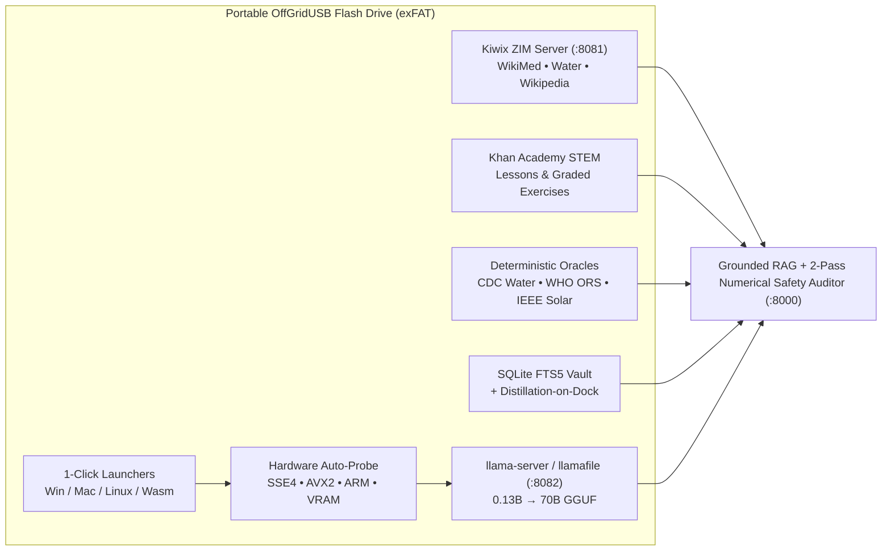

# OffGridUSB (`offgridusb.com`) — Universal Offline Knowledge, Internet-in-a-Box & Adaptive AI Harness

> **Zero Docker • Zero Cloud • Zero Installation • Single-Click Portable USB • 100% Air-Gapped**

**OffGridUSB** turns any ordinary USB flash drive or portable SSD into a self-contained **Internet-in-a-Box encyclopedia, STEM schoolhouse, life-safety engineering toolkit, and hardware-adaptive AI command center**.

Most "offline AI" or survival server projects fail the moment an actual grid-down outage happens: they expect a dedicated Ubuntu machine with Docker Compose pre-installed, crash on older 4 GB laptops lacking AVX2 instructions, cannot run on locked-down Chromebooks, and leave Wikipedia and local LLMs siloed in separate tabs where raw models hallucinate medical dosages and electrical math.

**OffGridUSB boots directly off the USB stick with a single click** across **Windows (x64 & ARM64), macOS (Apple Silicon & Intel), Linux, Raspberry Pi (ARM64), and locked Chromebooks (Pure-Browser WebAssembly)**—automatically probing the host CPU/RAM/VRAM and scaling from a 512 MB SBC up to a scavenged multi-laptop `exo`/`llama.cpp` RPC cluster or 70B workstation.

---

## Table of Contents

1. [1-Click Quick Start (Using a Ready OffGridUSB Stick)](#1-1-click-quick-start-using-a-ready-offgridusb-stick)
2. [Build Your Own OffGridUSB From Scratch (3 Steps)](#2-build-your-own-offgridusb-from-scratch-3-steps)
   - [Step 1 — Choose & Prepare Your USB Hardware (`exFAT` Guide)](#step-1--choose--prepare-your-usb-hardware-exfat-guide)
   - [Step 2 — Download Internet-in-a-Box (`.zim`), Portable Engines & AI Models](#step-2--download-internet-in-a-box-zim-portable-engines--ai-models)
   - [Step 3 — Format & Provision Your USB Drive(s)](#step-3--format--provision-your-usb-drives)
3. [Internet-in-a-Box & Elastic AI Catalog (`Tier 0` → `Tier 4`)](#3-internet-in-a-box--elastic-ai-catalog-tier-0--tier-4)
4. [Adding Custom Kiwix ZIM Libraries & Hugging Face GGUF Models](#4-adding-custom-kiwix-zim-libraries--hugging-face-gguf-models)
5. [Architecture & Core Subsystems](#5-architecture--core-subsystems)
6. [How OffGridUSB Compares to Project N.O.M.A.D. & Off-Grid AI](#6-how-offgridusb-compares-to-project-nomad--off-grid-ai)
7. [USB Directory Structure](#7-usb-directory-structure)
8. [CLI Reference, LAN Sharing & Troubleshooting](#8-cli-reference-lan-sharing--troubleshooting)

---

## 1. 1-Click Quick Start (Using a Ready OffGridUSB Stick)

Once your USB drive is provisioned, turn **Wi-Fi OFF / Airplane Mode ON** if desired, open the USB drive, and launch the starter for your machine:

| Host Device / Operating System | 1-Click Launcher | CLI / Custom Port Equivalent |
| :--- | :--- | :--- |
| **Windows 10 / 11 (`x86_64` & `ARM64`)** | Double-click **`START_EMYRGE_WINDOWS.bat`** | `run_windows.bat --port 8000` |
| **macOS (`Apple Silicon M1–M4` & `Intel`)** | Double-click **`START_EMYRGE_MAC.command`** | `./run_macos.command --port 8000` |
| **Linux & Raspberry Pi (`x86_64` & `ARM64`)** | Run **`./START_EMYRGE_LINUX.sh`** | `./run_linux.sh --port 8000` |
| **Locked Chromebook / Tablet (No Exec Rights)** | Open **`web/static/wasm/chromebook.html`** in Chrome | Pure-Browser WebAssembly Mode |

Once launched, three local services come online automatically with **zero internet traffic**:
- **`http://127.0.0.1:8000`** — **OffGridUSB Command Center** (Grounded AI Professor, Internet-in-a-Box Reader, Khan Academy STEM Tutor, CDC/WHO/IEEE Calculators, SQLite Memory Vault, Visual OCR Vault, and Swarm Planner).
- **`http://127.0.0.1:8081`** — **Embedded `kiwix-serve` ZIM Library** (full offline search & browsing across all `.zim` encyclopedias in `data/zim/`).
- **`http://127.0.0.1:8082`** — **Local `llama-server` / `llamafile` GGUF Engine** (auto-tuned thread count & context window for your probed hardware tier).

---

## 2. Build Your Own OffGridUSB From Scratch (3 Steps)

Because GitHub repositories do not store multi-gigabyte Wikipedia `.zim` archives or `.gguf` neural weights directly in Git history, this repository ships with **automated cross-platform provisioning, verification, formatting, and mass-cloning scripts** so anyone can build a complete OffGridUSB drive in minutes.

### Step 1 — Choose & Prepare Your USB Hardware (`exFAT` Guide)

Before formatting, match your flash drive or portable SSD to the knowledge tier you want to carry:

| USB Capacity | Recommended Build Tier | What Fits on the Drive | Required Filesystem |
| :--- | :--- | :--- | :--- |
| **8 GB – 16 GB** | **Tier 0 (Pocket Survival)** | Cross-OS engines + Safe Water + Field Medicine + WikiMed Mini + `Qwen2.5-0.5B` AI (~850 MB total) | **`exFAT`** *(or `FAT32`)* |
| **16 GB – 32 GB** | **Tier 1 (Legacy PC & Pi 4/5)** | Tier 0 + `SmolLM2-135M` + `Qwen2.5-1.5B` AI (~2.0 GB total) | **`exFAT`** *(or `FAT32`)* |
| **64 GB – 128 GB** | **Tier 2 (Full School + Wiki)** | Tier 1 + **Khan Academy STEM (4.6 GB)** + **Full English Wikipedia (50 GB)** + `Llama-3.2-3B` (~59 GB) | **`exFAT` REQUIRED** |
| **128 GB – 256 GB** | **Tier 3 (Scavenged Swarm)** | Tier 2 + **`Qwen2.5-32B` Distributed Swarm Model** (~78 GB total) | **`exFAT` REQUIRED** |
| **256 GB – 512 GB+** | **Tier 4 (Settlement Hub SSD)** | **Illustrated English Wikipedia Maxi (110 GB)** + **`Llama-3.3-70B` Frontier AI** (~230 GB total) | **`exFAT` REQUIRED** |

> **Why `exFAT` Is Strongly Recommended:**  
> Most factory 8 GB–32 GB USB sticks ship formatted as **FAT32**, which has a hard **4.0 GB single-file limit**. Full Wikipedia (`50 GB` / `110 GB`), Khan Academy (`4.6 GB`), and `3B+` AI models exceed 4 GB and **will fail to copy onto FAT32**. Formatting as **`exFAT`** (with a `128 KB` allocation unit size) works natively out-of-the-box on **Windows, macOS, Linux, Raspberry Pi OS, and ChromeOS** with no file-size ceiling.
>
> **Hardware Speed Tip:** Use a **USB 3.1 / 3.2 Gen 1+** flash drive (e.g., SanDisk Extreme Pro, Samsung BAR Plus) or an external **NVMe/SATA USB SSD enclosure** (`>= 150 MB/s` read speed) so multi-gigabyte `.gguf` weights memory-map into RAM in seconds.

Clone this repository onto a machine that currently has internet access:

```bash
git clone https://github.com/TheBlindHacker/offgridUSB.git
cd offgridUSB
```

---

### Step 2 — Download Internet-in-a-Box (`.zim`), Portable Engines & AI Models

Our provisioning scripts automatically fetch and header-verify:
1. **Zero-Install Cross-Platform Engines (`bin/`):** Portable Python 3.12.8 Embeddable (Windows), `kiwix-tools 3.8.1` (`kiwix-serve` for Windows, Linux `x86_64`, Raspberry Pi `ARM64`, and macOS), `llama.cpp` (`llama-server` for Windows `x64`/`ARM64`, Linux `x64`/`ARM64`, macOS Apple Silicon & Intel), and Mozilla's polyglot `llamafile`.
2. **Internet-in-a-Box OpenZIM Libraries (`data/zim/`):** Official offline encyclopedias from `download.kiwix.org` verified via `ZIM\x04` magic headers.
3. **Offline GGUF AI Models (`data/models/`):** Quantized `Q4_K_M` instruction models verified via `GGUF` magic headers.

*(All downloads use resumable HTTP byte-ranges via `curl -C -`, so interrupted multi-gigabyte Wikipedia downloads pick up right where they left off!)*

#### Option A: Windows (1-Click Interactive Wizard or PowerShell CLI)

Double-click **`DOWNLOAD_INTERNET_IN_A_BOX.bat`** to open the interactive tier menu, **or** run from PowerShell:

```powershell
# Tier 0 Pocket Survival Pack (~850 MB — fastest way to build & test your first USB)
.\scripts\download_internet_in_a_box.ps1 -Tier 0 -NonInteractive

# Tier 2 Full Civilization & STEM Schoolhouse (~59 GB — adds Khan Academy + 50GB English Wikipedia)
.\scripts\download_internet_in_a_box.ps1 -Tier 2 -NonInteractive

# Verify all staged engines, .zim headers, and .gguf models on disk
.\scripts\download_internet_in_a_box.ps1 -Verify
```

#### Option B: Linux, Raspberry Pi & macOS (Bash CLI)

```bash
chmod +x scripts/*.sh *.sh *.command

# Tier 0 Pocket Survival Pack (~850 MB — includes cross-OS binaries so the USB works everywhere)
./scripts/download_internet_in_a_box.sh --tier 0

# Tier 2 Full Civilization Pack (~59 GB — adds Khan Academy + 50GB English Wikipedia)
./scripts/download_internet_in_a_box.sh --tier 2

# Optional: Stage binaries ONLY for your current OS/CPU to save ~90 MB of USB space
./scripts/download_internet_in_a_box.sh --tier 0 --current-os-only

# Verify all staged .zim and .gguf files
./scripts/download_internet_in_a_box.sh --verify
```

#### Option C: Pure Python Standard-Library Manifest Provisioner (Any OS)

If you already have engines staged (or only want to inspect/fetch `.zim` and `.gguf` packs from [`manifests/zim.json`](manifests/zim.json) and [`manifests/models.json`](manifests/models.json)):

```bash
# List every available Internet-in-a-Box ZIM archive and GGUF model in the catalog
PYTHONPATH=src python3 -m emyrge.assets.fetch_assets --list

# Preview planned downloads for Tier 2 without downloading
PYTHONPATH=src python3 -m emyrge.assets.fetch_assets --dry-run --tier 2

# Download only Internet-in-a-Box ZIMs up to Tier 2, or fetch a single item by ID
PYTHONPATH=src python3 -m emyrge.assets.fetch_assets --zim-only --tier 2
PYTHONPATH=src python3 -m emyrge.assets.fetch_assets --id khanacademy-en
```

---

### Step 3 — Format & Provision Your USB Drive(s)

Every OffGridUSB formatting and cloning tool includes **hard safety blocks** that refuse to format or overwrite `C:`, `/`, `/System`, `/dev/disk0`, or any OS boot/system partition.

#### On Windows

- **Format (`exFAT` / `FAT32`) + Full Setup Wizard:**  
  Plug in your USB drive and double-click **`FORMAT_AND_SETUP_USB.bat`** (runs [`scripts/format_and_setup_usb.ps1`](scripts/format_and_setup_usb.ps1)).
  - Displays physical USB bus info, capacity, and current filesystem.
  - Offers **`[1] Format as exFAT (128 KB allocation units — Recommended)`**, **`[2] Format as FAT32`**, or **`[3] Keep Existing Filesystem (Non-Destructive Copy)`**.
  - Automatically checks if any staged `.zim`/`.gguf` exceeds 4 GB so you never waste time copying onto FAT32, requires explicit typed confirmation (`FORMAT E`) before erasing, and runs 16-thread `robocopy /MT:16`.

- **Mass-Clone 2, 5, or 20 Identical USB Drives (`< 45 Seconds` per Stick):**  
  Already have formatted USB drives ready? Double-click **`MAKE_USB_DRIVES.bat`** (runs [`scripts/clone_to_usb.ps1`](scripts/clone_to_usb.ps1)). After each stick finishes, swap in the next flash drive and press **`Y`** to clone another copy immediately.

#### On Linux & macOS

Use [`scripts/setup_usb_unix.sh`](scripts/setup_usb_unix.sh) to inspect external drives, format as `exFAT`, and sync the runtime cleanly (preserving POSIX `+x` permissions while skipping `.git`, caches, and temp files):

```bash
# 1. Inspect connected external USB drives and mountpoints
./scripts/setup_usb_unix.sh --list

# 2A. Format an external USB drive as exFAT (DESTRUCTIVE — requires typing 'FORMAT <dev>')
#     • macOS example (whole external disk):
./scripts/setup_usb_unix.sh --format-exfat /dev/disk4 --label OFFGRIDUSB
#     • Linux example (external USB partition — requires `exfatprogs` installed):
./scripts/setup_usb_unix.sh --format-exfat /dev/sdb1 --label OFFGRIDUSB

# 2B. Or non-destructively copy/update OffGridUSB onto an already-mounted USB drive:
./scripts/setup_usb_unix.sh --copy /Volumes/OFFGRIDUSB            # macOS
./scripts/setup_usb_unix.sh --copy /media/$USER/OFFGRIDUSB        # Ubuntu / Debian / Pi OS
```

<details>
<summary><strong>Prefer Formatting Manually with Your OS GUI Tools? (Click to Expand)</strong></summary>

1. **Windows Explorer:** Right-click your USB drive in *This PC* → **Format...** → File system: **`exFAT`** → Allocation unit size: **`128 kilobytes`** → Volume label: `OFFGRIDUSB` → **Quick Format** → **Start**, then run **`MAKE_USB_DRIVES.bat`**.
2. **macOS Disk Utility:** Open *Disk Utility* → *View → Show All Devices* → Select your external USB flash drive → **Erase** → Format: **`ExFAT`**, Scheme: **`Master Boot Record (MBR)`** *(or GUID Partition Map)*, Name: `OFFGRIDUSB` → **Erase**, then run `./scripts/setup_usb_unix.sh --copy /Volumes/OFFGRIDUSB`.
3. **Linux GNOME Disks (`gnome-disks`):** Select your USB stick → click the partition gears icon → **Format Partition...** → Type: **Other → `exFAT`** → Name: `OFFGRIDUSB`, mount it, and run `./scripts/setup_usb_unix.sh --copy /media/$USER/OFFGRIDUSB`.

</details>

---

## 3. Internet-in-a-Box & Elastic AI Catalog (`Tier 0` → `Tier 4`)

### Built-In Internet-in-a-Box OpenZIM Packs ([`manifests/zim.json`](manifests/zim.json))

| Tier | Manifest ID | Archive Title | Approx. Size | Primary Use Case |
| :---: | :--- | :--- | :---: | :--- |
| **0** | `zimgit-water` | **ZimGit Safe Water & Emergency Sanitation Manual** | `20 MB` | Filtration, chlorination, solar disinfection, well & latrine construction |
| **0** | `zimgit-medicine` | **ZimGit Austere Field Medicine & First Aid** | `67 MB` | Trauma care, wound management, dental/austere clinical procedures |
| **0** | `wikipedia-medicine-mini` | **Wikipedia English Medicine Mini** | `166 MB` | Offline pharmacology, triage, pathology & clinical reference |
| **2** | `khanacademy-en` | **Khan Academy Offline STEM & K-12 Complete Pack** | `4.6 GB` | Full offline math, physics, chemistry, electrical & biology lessons |
| **2** | `wikipedia-en-nopic-50gb` | **Full English Wikipedia (Compact No-Pictures Edition)** | `50.0 GB` | Every article in English Wikipedia (~6.8M+ articles) for 64GB+ USBs |
| **4** | `wikipedia-en-maxi-110gb` | **Full Illustrated English Wikipedia (Maxi Edition)** | `110.0 GB` | Complete Wikipedia with diagrams, anatomy plates & maps for 256GB+ SSDs |

### Built-In Elastic GGUF Model Ladder ([`manifests/models.json`](manifests/models.json))

| Tier | Manifest ID | Model (`Q4_K_M`) | Disk Size | Min RAM | Target Hardware & Prompting Strategy |
| :---: | :--- | :--- | :---: | :---: | :--- |
| **0** | `smollm2-135m-q4` | `SmolLM2-135M-Instruct` | `101 MB` | `512 MB` | Chromebook Wasm / Raspberry Pi Zero 2 (`search_then_summarize`) |
| **0** | `qwen2.5-0.5b-q4` | `Qwen2.5-0.5B-Instruct` *(Default)* | `379 MB` | `1 GB` | Universal instant-boot USB baseline (`search_then_summarize`) |
| **1** | `qwen2.5-1.5b-instruct-q4` | `Qwen2.5-1.5B-Instruct` | `1.06 GB` | `3 GB` | 10-year-old 4 GB SSE4.2 laptops & Raspberry Pi 4/5 (`search_then_summarize`) |
| **2** | `llama-3.2-3b-instruct-q4` | `Llama-3.2-3B-Instruct` | `1.93 GB` | `8 GB` | Modern AVX2 / Apple Metal / CUDA / Vulkan laptops (`tool_calling`) |
| **3** | `qwen2.5-32b-instruct-q4` | `Qwen2.5-32B-Instruct` | `18.9 GB` | `24 GB` | Pooled RAM across 2–8 weak LAN machines via `exo` / `llama.cpp` RPC (`tool_calling`) |
| **4** | `llama-3.3-70b-instruct-q4` | `Llama-3.3-70B-Instruct` | `40.6 GB` | `64 GB` | Multi-GPU Settlement Hub & "Distillation-on-Dock" teacher (`tool_calling`) |

---

## 4. Adding Custom Kiwix ZIM Libraries & Hugging Face GGUF Models

OffGridUSB uses **automatic runtime discovery**—you do **not** have to edit code to expand your drive's library:

1. **Add Any Custom `.zim` Archive (Stack Overflow, iFixit, Project Gutenberg, Ted Talks, MDWiki):**
   - Browse thousands of free archives at **[library.kiwix.org](https://library.kiwix.org/)** or **[download.kiwix.org/zim/](https://download.kiwix.org/zim/)**.
   - Drop any downloaded `.zim` file directly into **`data/zim/`** on your USB stick.
   - On next launch (or automatically at runtime), `KiwixRunner` validates the `ZIM\x04` header, mounts the archive on `:8081`, and makes its articles immediately searchable by the AI Professor RAG pipeline!
2. **Add Any Custom `.gguf` Model:**
   - Download any `.gguf` file from Hugging Face and place it into **`data/models/`** on your USB stick.
   - `ModelRunner` automatically verifies the `GGUF` magic header and exposes it to the hardware tier orchestrator.

---

## 5. Architecture & Core Subsystems



1. **Grounded AI Professor + 2-Pass Numerical Safety Audit:** Every response retrieves passages across offline ZIM encyclopedias, Khan Academy STEM lessons, and Verified Master Notes with clickable `[Source: ...]` citations, then runs a deterministic **2-Pass Numerical Claim Auditor** that flags any dosage or measurement not supported by retrieved sources.
2. **Internet-in-a-Box (`kiwix-serve` + Native ZIM Reader + Khan Academy Tutor):** Hosts real `.zim` archives alongside interactive STEM lessons and graded practice problems—plus a zero-AI **Direct Lookup Mode** for sub-millisecond retrieval when conserving battery.
3. **Zero-Hallucination Life-Safety Calculators:** Pure-Python deterministic engines for **CDC/WHO Emergency Water Chlorination**, **WHO Oral Rehydration & Pediatric Dosing**, **IEEE 1562 Off-Grid Solar & LiFePO4 Battery Sizing**, and **NEC DC Voltage Drop / Ohm's Law**.
4. **Self-Improving SQLite FTS5 Memory & "Distillation-on-Dock":** Low-confidence field queries asked on weak 4 GB hardware are flagged in `data/vault/memory.sqlite`. Whenever the USB stick later docks with a high-spec workstation or cluster, queued questions are automatically upgraded into **Verified Master Field Notes** that stay on the USB permanently.
5. **Visual Field Vault:** Offline EXIF/GPS metadata extraction and OCR indexing so photos of pill bottles, wiring plates, and schematics remain full-text searchable on zero-GPU hardware.
6. **Exo & `llama.cpp` RPC Scavenged Swarm + LoRa Mesh Framing:** Pools heterogeneous LAN laptops into a distributed 32B cluster with graceful local fallback if a node drops, and chunks answers into `<= 200`-byte numbered packets for Meshtastic / LoRa field radios.

See **[`docs/PRD_ARD.md`](docs/PRD_ARD.md)** for full architectural specifications.

---

## 6. How OffGridUSB Compares to Project N.O.M.A.D. & Off-Grid AI

| Capability | Project N.O.M.A.D. | Off-Grid AI | **OffGridUSB (`offgridusb.com`)** |
| :--- | :--- | :--- | :--- |
| **Setup & Boot** | Linux OS + Docker Compose install | Per-device app install | **1-Click Zero-Install off USB (+ Wasm Browser Mode)** |
| **Hardware Elasticity** | Fails on old 4 GB / non-AVX2 PCs | Static local model | **Probes SSE4/AVX2/AVX-512/ARM/VRAM (`Tier -1` to `Tier 4`)** |
| **Knowledge Grounding** | Siloed Kiwix & Ollama tabs | Static survival PDFs | **Unified RAG over ZIM Encyclopedias + Khan Academy** |
| **Life-Safety Math** | Raw LLM (hallucination risk) | Raw LLM | **Deterministic CDC/WHO/IEEE Calculators + 2-Pass Audit** |
| **Self-Improving USB** | Stateless | Basic chat history | **SQLite FTS5 Vault + "Distillation-on-Dock" Upgrades** |
| **Scavenged Swarm** | Single-node only | Single-device only | **Pools mismatched laptops via `exo` & `llama.cpp` RPC** |

---

## 7. USB Directory Structure

```text
OFFGRIDUSB/
├── START_EMYRGE_WINDOWS.bat          # 1-Click Windows launcher (auto-opens browser + LAN IP)
├── START_EMYRGE_MAC.command          # 1-Click macOS launcher (Apple Silicon & Intel)
├── START_EMYRGE_LINUX.sh             # 1-Click Linux & Raspberry Pi launcher
├── DOWNLOAD_INTERNET_IN_A_BOX.bat    # 1-Click Windows Internet-in-a-Box & AI downloader
├── FORMAT_AND_SETUP_USB.bat          # 1-Click Windows safe USB formatter (exFAT/FAT32) & setup
├── MAKE_USB_DRIVES.bat               # 1-Click multi-USB mass cloner (< 45s per drive)
├── run_windows.bat / run_linux.sh / run_macos.command
├── manifests/
│   ├── zim.json                      # OpenZIM Internet-in-a-Box catalog (Tier 0 -> Tier 4)
│   └── models.json                   # Quantized GGUF model catalog (0.13B -> 70B)
├── scripts/
│   ├── download_internet_in_a_box.ps1 # Resumable Windows asset + engine provisioner
│   ├── download_internet_in_a_box.sh  # Resumable Linux / Raspberry Pi / macOS provisioner
│   ├── format_and_setup_usb.ps1       # Safe Windows exFAT/FAT32 formatter & provisioner
│   ├── clone_to_usb.ps1               # 16-thread Robocopy multi-USB mass cloner
│   └── setup_usb_unix.sh              # Safe Linux & macOS exFAT formatter & rsync cloner
├── bin/                              # Populated by download scripts (zero-install native engines)
│   ├── windows_x86_64/               # Embeddable Python 3.12, kiwix-serve.exe, llama-server.exe
│   ├── windows_arm64/                # Native Snapdragon / Surface ARM64 llama-server.exe
│   ├── linux_x86_64/ & linux_arm64/  # Auto-extracted POSIX .tar.gz bundles (safe on exFAT/noexec)
│   ├── macos_arm64/ & macos_x86_64/  # Apple Silicon Metal & Intel Kiwix + llama-server bundles
│   └── polyglot/                     # Cosmopolitan llamafile universal fallback
├── data/                             # Populated on USB (gitignored in source repo)
│   ├── zim/                          # *.zim Internet-in-a-Box offline encyclopedias
│   ├── models/                       # *.gguf quantized offline LLM weights
│   ├── vault/                        # Persistent SQLite FTS5 memory & Verified Master Notes
│   └── uploads/                      # Field photos indexed by offline EXIF + OCR Visual Vault
├── src/emyrge/                       # 100% pure Python stdlib backend (zero pip dependencies!)
└── web/static/                       # Offline SPA + pure-browser Chromebook Wasm shell
```

---

## 8. CLI Reference, LAN Sharing & Troubleshooting

- **Share With Phones & Tablets Over Base-Camp Wi-Fi (Zero App Install):**  
  `START_EMYRGE_WINDOWS.bat`, `START_EMYRGE_MAC.command`, and `START_EMYRGE_LINUX.sh` automatically bind `--host 0.0.0.0` so any phone, tablet, or peer laptop on the same local router/hotspot (even with zero WAN internet) can open `http://<HOST_LAN_IP>:8000` in its mobile browser. To bind strictly to localhost only, run `./run_linux.sh --host 127.0.0.1 --port 8000`.
- **macOS "Unidentified Developer" Gatekeeper Tip:**  
  If macOS quarantines scripts downloaded from a browser zip, open Terminal in the USB folder once and clear the quarantine attribute:
  ```bash
  xattr -dr com.apple.quarantine .
  chmod +x *.command *.sh scripts/*.sh
  ```
- **Linux USB Mounted `noexec` (`FAT32` / `exFAT`):**  
  Many Linux desktops auto-mount removable USB sticks with the `noexec` flag, which normally blocks running native binaries directly off USB. OffGridUSB's `KiwixRunner` and `ModelRunner` automatically detect `noexec` mounts and transparently stage/extract native `.tar.gz` binaries + `.so` symlinks into `/tmp/emyrge_runtime` in RAM.
- **Custom Port Override (If Port `8000` Is Busy):**  
  Pass `--port 8090` to `run_windows.bat`, `./run_linux.sh`, or `./run_macos.command`, or set `EMYRGE_PORT=8090`.
- **Life-Safety Disclaimer:**  
  OffGridUSB provides offline access to public-domain/open-license medical, sanitation, and engineering references alongside deterministic formula calculators for educational resilience and emergency preparedness. Always cross-check critical clinical or electrical decisions against primary source articles (`[Source: ...]`) and qualified professionals whenever reachable.
